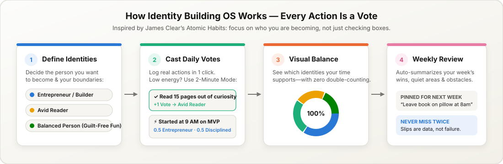
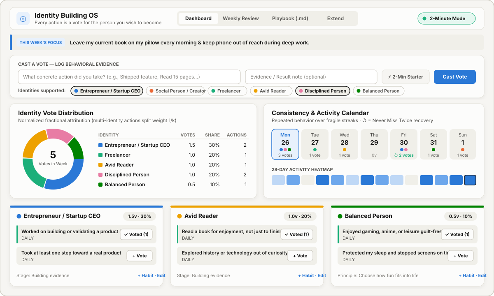
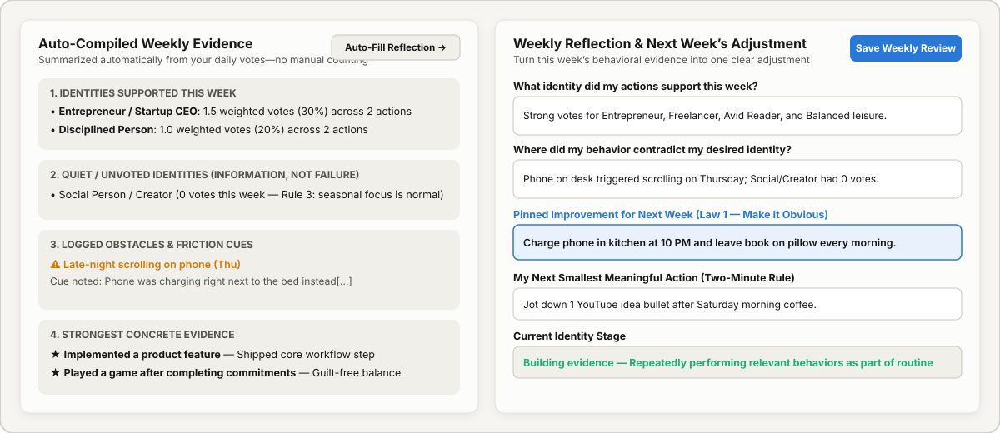

# Identity Building OS

**A calm, visual personal system for becoming who you want to be—one small action at a time.**  
*Inspired by **Atomic Habits** by James Clear.*

[](LICENSE)

---

## Why This Exists

Most habit trackers fail for the same reason: **they turn your life into an exhausting wall of checkboxes and fragile streaks.** Miss one day, break a streak, and you feel like starting over—or worse, you start checking boxes just to keep a score alive rather than doing things that actually matter.

In *Atomic Habits*, James Clear offers a better way:

> *“Every action you take is a vote for the type of person you wish to become. No single instance will transform your beliefs, but as the votes build up, so does the evidence of your new identity.”*

**Identity Building OS** replaces overwhelming tables and guilt-inducing streaks with a simple, visual space where you:
1. **Define the identities you want to build** (such as *Entrepreneur*, *Avid Reader*, *Creator*, or *Balanced Person*).
2. **Record real actions in one click** as “votes” for those identities.
3. **See a clear pie chart of who your daily and weekly actions are actually supporting.**
4. **Enjoy guilt-free fun and rest**—because a balanced life includes games, stories, and sleep, not endless productivity.



---

## A Tour of Your System

### 1. The Daily & Weekly Dashboard

Instead of scrolling through dozens of checkboxes, everything you need is on one calm screen:



- **This Week’s Focus Banner (Top):** Keeps the single improvement you chose in last week’s review right in front of you (*Law 1: Make It Obvious*).
- **One-Click Habit Votes:** Each identity has its own card with your recurring habits. Click **+ Vote** whenever you take action.
- **Quick-Capture Bar:** Did something great that isn’t on a habit card? Type what you did, click the identity (or multiple identities) it supports, and press **Cast Vote**.
- **2-Minute Mode (Top Right):** Having a low-energy day? Flip on **2-Minute Mode** and every habit automatically scales down to an easy two-minute starter version (*“Read 2 pages”* instead of *“Read a chapter”*).
- **True Identity Balance Pie Chart:** Shows how your actions distribute across your identities. If one action supports two identities at once (for example, *“Started building my product at 9 AM as planned”* supports both **Entrepreneur** and **Disciplined Person**), the chart splits the vote fairly ($0.5$ each) so nothing is ever double-counted.
- **“Never Miss Twice” Calendar:** Instead of punishing you for missing a day, the calendar celebrates **recovery days (`↺`)** whenever you bounce back after a quiet day.

---

### 2. Anti-Identities & Guilt-Free Fun

> **Core Principle:** *“I am not trying to eliminate fun. I am choosing how fun fits into my life.”*

Building discipline should never mean eliminating joy. Identity Building OS treats **Balanced Person** as a first-class identity alongside your work and learning goals:
- **Enjoy leisure without guilt:** Playing a game, watching anime or a movie, or resting after finishing your key commitment counts as a real, positive vote for being a **Balanced Person**.
- **Protect your boundaries (Anti-Identities):** Track boundary wins when you avoid mindless short-form scrolling (like TikTok/brainrot feeds) or stop gaming on time to protect your sleep.
- **Missing a habit is information, not failure:** If a distraction wins, log it as an **Obstacle** with a quick note about what triggered it (for example, *“Phone was on my desk”*). That note is saved for your Weekly Review so you can fix your environment next week instead of blaming willpower.

---

### 3. Guided Weekly Review (No Manual Counting)

You don’t need to review your system every single day. Once a week, open the **Weekly Review** tab:



- **Left Side — Your Automatic Summary:** The app automatically gathers your week’s votes, highlights which identities got the most attention, gently notes which identities were quiet (remembering that not every identity needs equal attention every week), and lists any obstacles you logged.
- **Right Side — Four Simple Questions:** Reflect on what worked, what got in the way, and choose **one small adjustment for next week**—which automatically pins itself to the top of your Dashboard.

---

### 4. Built-In Atomic Habits Playbook & Full Customization

- **Atomic Habits Playbook Tab:** Practical guides, examples, and Two-Minute Rule starters for all **Four Laws of Behavior Change** (*Make It Obvious, Make It Attractive, Make It Easy, Make It Satisfying*) are stored as simple, readable Markdown notes inside the [`guidance/`](guidance/) folder. You can read or edit them right inside the app.
- **Grows With You (`Extend & Configure` Tab):** Nothing is locked in. You can add new identities, rename or recolor existing ones, add new habits or guardrails, and customize your weekly reflection questions at any time.

---

## How to Start Using It (2 Simple Steps)

Identity Building OS runs privately on your own computer with zero subscriptions, accounts, or internet connection required.

1. **Open a terminal in this folder and start the app:**
   ```bash
   python app.py
   ```
2. **Open your web browser and visit:**
   ```text
   http://127.0.0.1:8765
   ```

*(On the very first launch, the app automatically reads [`base_database.md`](base_database.md) to set up your initial identities, habits, and examples while keeping your original Markdown file untouched.)*

---

## The 7 Golden Rules of This System

1. **Review weekly, not obsessively every day.**
2. **Record a vote only when you have real evidence that you did the behavior.**
3. **Do not expect every identity to receive equal attention every week.**
4. **Missing a habit is information, not a verdict on your character.**
5. **Use the Two-Minute Rule to make starting easier, not as a permanent substitute for meaningful work.**
6. **Prioritize repeated behavior over streaks, perfect scores, and self-labels.**
7. **Keep entertainment as a legitimate part of a balanced life.**

---

## License

This project is open source and available under the [MIT License](LICENSE).
