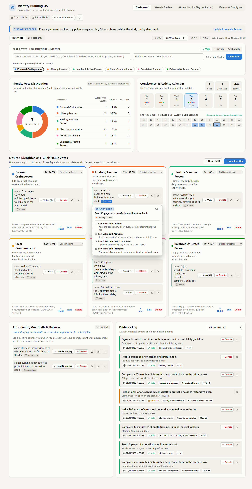
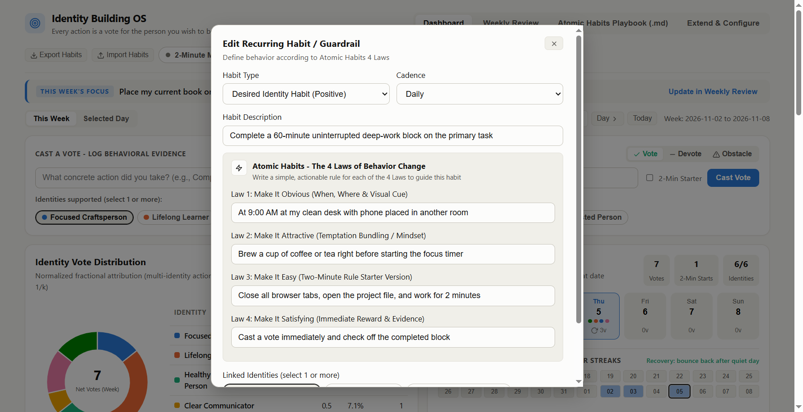
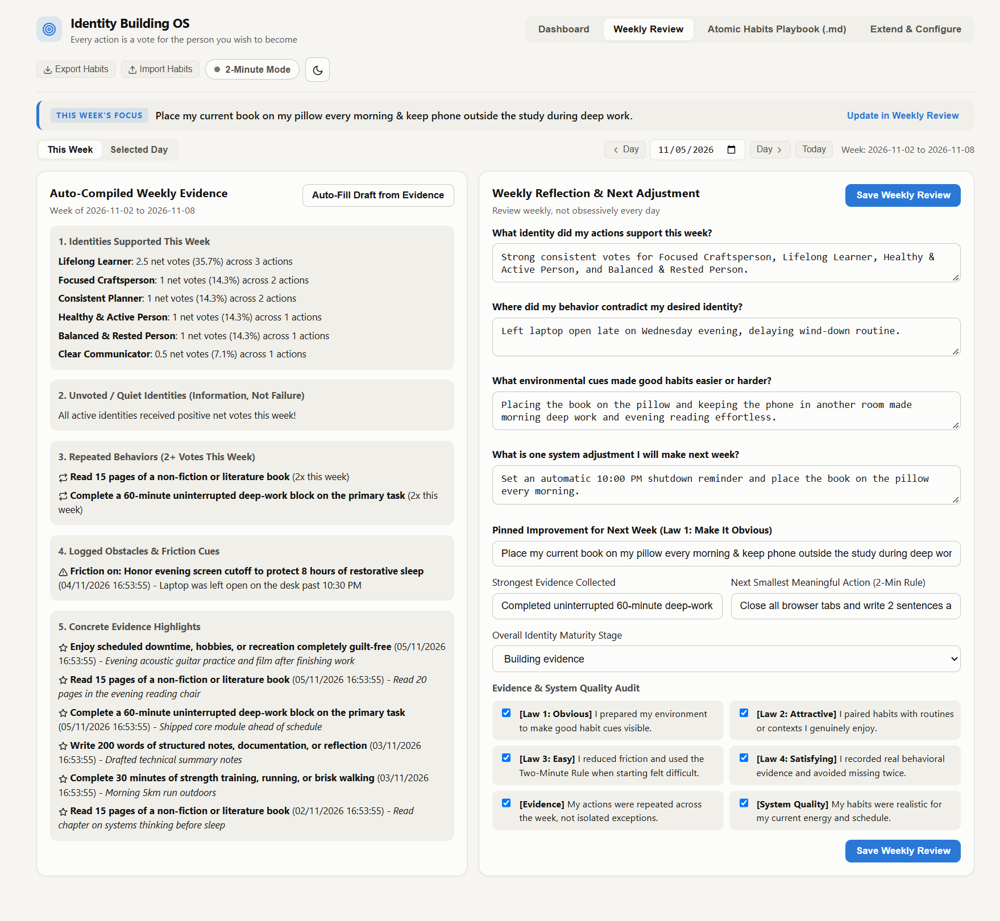

# Identity Building OS

**A calm, visual personal system for becoming who you want to be—one small action at a time.**  
*Inspired by **Atomic Habits** by James Clear.*

[](LICENSE)

---

## Why This Exists

Most habit trackers fail for the same reason: **they turn your life into an exhausting wall of checkboxes and fragile streaks.** Miss one day, break a streak, and you feel like starting over—or worse, you start checking boxes just to keep a score alive rather than doing things that actually matter.

In *Atomic Habits*, James Clear offers a better way:

> *"Every action you take is a vote for the type of person you wish to become. No single instance will transform your beliefs, but as the votes build up, so does the evidence of your new identity."*

**Identity Building OS** replaces overwhelming tables and guilt-inducing streaks with a simple, visual space where you:
1. **Define the identities you want to build** (such as *Focused Craftsperson*, *Lifelong Learner*, *Healthy & Active Person*, or *Balanced & Rested Person*).
2. **Record real actions in one click** as "votes" for those identities.
3. **See a clear pie chart of who your daily and weekly actions are actually supporting.**
4. **Enjoy guilt-free rest and recreation**—because a balanced life includes hobbies, leisure, and sleep, not endless productivity.

---

## A Tour of Your System

### 1. The Daily & Weekly Dashboard

Instead of scrolling through dozens of checkboxes, everything you need is on one calm screen:



- **This Week's Focus Banner (Top):** Keeps the single improvement you chose in last week's review right in front of you (*Law 1: Make It Obvious*).
- **One-Click Habit Votes & Individual Hover Metadata:** Each identity has its own card with your recurring habits. Hover over any habit to immediately inspect that specific habit's configured 4 Laws rules without opening the edit modal, or click **Vote** whenever you take action.
- **Quick-Capture Bar:** Did something meaningful that isn't on a habit card? Type what you did, select the identity (or multiple identities) it supports, and press **Cast Vote**.
- **2-Minute Mode (Top Right):** Having a low-energy day? Flip on **2-Minute Mode** and every habit automatically scales down to an easy two-minute starter version (*"Read 1 page"* instead of *"Read 15 pages"*).
- **True Identity Balance Pie Chart:** Shows how your actions distribute across your identities. If one action supports two identities at once (for example, *"Complete a 60-minute uninterrupted deep-work block"* supports both **Focused Craftsperson** and **Consistent Planner**), the chart splits the vote fairly ($0.5$ each) so nothing is ever double-counted.
- **"Never Miss Twice" Calendar:** Instead of punishing you for missing a day, the calendar highlights **recovery days** whenever you bounce back after a quiet day.

---

### 2. The 4 Laws of Behavior Change (Per-Habit Rules & Inversions)

Every recurring habit or boundary guardrail lets you write four simple, actionable strings for the **Four Laws of Behavior Change**—and hovering over any habit on your dashboard displays its exact metadata at a glance:



- **Desired Identity Habits (The 4 Laws):**
  1. **Law 1: Make It Obvious** — When, where, and what visual cue triggers the habit.
  2. **Law 2: Make It Attractive** — How you pair or frame the habit so you look forward to it.
  3. **Law 3: Make It Easy (Two-Minute Rule)** — The two-minute starter version for low-energy days.
  4. **Law 4: Make It Satisfying** — The immediate reward and evidence you record upon completion.
- **Anti-Identity Guardrails (The 4 Inversions):**
  - When configuring an **Anti-Identity Guardrail**, the four fields automatically invert to **Make It Invisible**, **Make It Unattractive**, **Make It Difficult**, and **Make It Unsatisfying**.

---

### 3. Anti-Identities & Balanced Living

> **Core Principle:** *"I am not trying to eliminate fun. I am choosing how fun fits into my life."*

Building consistency should never mean eliminating joy. Identity Building OS treats **Balanced & Rested Person** as a first-class identity alongside your craft and growth goals:
- **Enjoy leisure without guilt:** Taking scheduled downtime, enjoying a hobby, or resting after finishing your key commitment counts as a real, positive vote for being a **Balanced & Rested Person**.
- **Protect your boundaries (Anti-Identities):** Track boundary wins when you avoid reactive morning feeds or honor your evening screen curfew to protect restorative sleep.
- **Missing a habit is information, not failure:** If a distraction cue wins, log it as an **Obstacle** with a quick note about what triggered it (for example, *"Phone was left on the desk"*). That note is saved for your Weekly Review so you can adjust your environment next week instead of blaming willpower.

---

### 4. Guided Weekly Review (No Manual Counting)

You don't need to review your system every single day. Once a week, open the **Weekly Review** tab:



- **Left Side — Your Automatic Summary:** The app automatically gathers your week's votes, highlights which identities received the most attention, gently notes which identities were quiet (remembering that not every identity needs equal attention every week), and lists any obstacles you logged.
- **Right Side — Four Simple Questions:** Reflect on what worked, what got in the way, and choose **one small adjustment for next week**—which automatically pins itself to the top of your Dashboard.

---

### 5. Built-In Atomic Habits Playbook & Full Customization

- **Atomic Habits Playbook Tab:** Practical guides, archetypes, and Two-Minute Rule starters for all **Four Laws of Behavior Change** are stored as clean, readable Markdown notes inside the [`guidance/`](guidance/) folder. You can read or edit them right inside the app.
- **Grows With You (`Extend & Configure` Tab):** Nothing is locked in. You can add new identities, rename or recolor existing ones, add or edit habits and guardrails, and customize your weekly reflection questions at any time.

---

## How to Start Using It (2 Simple Steps)

Identity Building OS runs privately on your own computer with zero subscriptions, accounts, or internet connection required.

### Desktop App Launch (Electron)
Run Identity Building OS as a dedicated native desktop application with system menus, window controls, and native file dialogs:

1. **Install Electron dependencies (first time only):**
   ```bash
   npm install
   ```
2. **Launch the desktop application:**
   ```bash
   npm start
   ```
*(Electron automatically starts the local Python backend in the background and shuts it down cleanly when you close the app.)*

### Standard Manual Web Launch
1. **Open a terminal in this folder and start the app:**
   ```bash
   python app.py
   ```
2. **Open your web browser and visit:**
   ```text
   http://127.0.0.1:8765
   ```

### Save or Share Your Identities & Habits (JSON Export / Import)
You can easily export and import your **Identities and Habits** (along with their 4 Laws rules) as a clean JSON file to back up your setup or share habit templates—without exposing or overwriting your logged action history or weekly reviews:

- **In the UI:** Use the **Export Habits** / **Import Habits** buttons in the top bar or inside the **Extend & Configure** tab.
- **Via CLI:**
  ```bash
  # Export your identities and habits to a JSON file
  python app.py --export my_habits.json

  # Import and merge identities and habits from a JSON file (default safe merge)
  python app.py --import my_habits.json

  # Import and replace the active habits list while preserving all logged actions and reviews
  python app.py --import my_habits.json --replace
  ```

### Running as a Background Service & On Windows Startup

You can run the app silently in the background (no open terminal window) and have it automatically launch every time your computer starts or logs in:

```powershell
# Check status of service and startup configuration
.\service.bat status

# Install to Windows startup and start in the background immediately
.\service.bat install

# Other service controls
.\service.bat start       # Start background service
.\service.bat stop        # Stop background service
.\service.bat restart     # Restart service
.\service.bat open        # Open dashboard in default browser
.\service.bat uninstall   # Remove from startup and stop service
```

---

## The 7 Golden Rules of This System

1. **Review weekly, not obsessively every day.**
2. **Record a vote only when you have real evidence that you did the behavior.**
3. **Do not expect every identity to receive equal attention every week.**
4. **Missing a habit is information, not a verdict on your character.**
5. **Use the Two-Minute Rule to make starting easier, not as a permanent substitute for meaningful work.**
6. **Prioritize repeated behavior over streaks, perfect scores, and self-labels.**
7. **Keep recreation and rest as a legitimate part of a balanced life.**

---

## License

This project is open source and available under the [MIT License](LICENSE).
